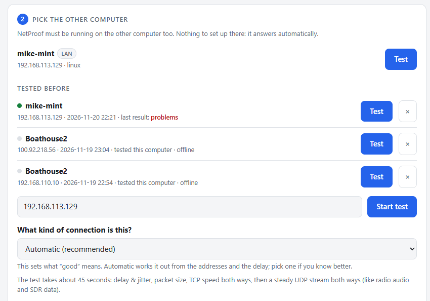

# NetProof

A network tester that anyone can run. It measures speed, delay, jitter, packet loss and packet
size between two computers, and says in plain language whether you would notice a problem and
how to fix it. One file, nothing to install.

**[Download the latest release](https://github.com/va3mw/netproof/releases/latest)** ·
**[Project page](https://va3mw.github.io/netproof/)**

Built for ham radio operators, whose remote audio, panadapter and SDR streams are UDP and
suffer from problems an ordinary speed test never shows.

- [Download](#download)
- [Quick start](#quick-start)
- [What it measures](#what-it-measures)
- [How results are judged](#how-results-are-judged)
- [Features](#features)
- [Ask an AI](#ask-an-ai)
- [Versions and updates](#versions-and-updates)
- [What's new](#whats-new)
- [Command line](#command-line)
- [Ports and security](#ports-and-security)
- [Known issues](#known-issues)
- [Building](#building)
- [Project layout](#project-layout)

## Download

Get the file for each computer from
**[Releases](https://github.com/va3mw/netproof/releases/latest)**:

| Computer | File |
|---|---|
| Windows (most PCs) | `netproof.exe` |
| Windows on ARM | `netproof-windows-arm64.exe` |
| Mac (Apple Silicon or Intel) | `NetProof-mac.zip` |
| Debian, Ubuntu or other Linux PC | `netproof-linux-amd64` |
| Raspberry Pi (64-bit OS) or other ARM Linux | `netproof-linux-arm64` |

On Linux you can download it straight from the terminal:

```bash
wget https://github.com/va3mw/netproof/releases/latest/download/netproof-linux-amd64
```

Use `netproof-linux-arm64` in that link on a Raspberry Pi. The Linux files are static programs
and run on any Debian release with nothing else installed. Once a copy is running, it keeps
itself up to date (see [Versions and updates](#versions-and-updates)).

## Quick start



1. Run NetProof on **both** computers: `netproof.exe` on Windows, `NetProof.app` on a Mac
   (from `NetProof-mac.zip`), `netproof-linux-amd64` on Debian. A browser page opens by itself.
2. On **one** of them, click **Test** next to the other computer's name. If it is not listed
   (VPN, Tailscale, another subnet), type its address or name and click **Start test**.
3. Wait about 45 seconds. Both screens show the verdict and, if needed, a "How to fix it"
   checklist.

There is no client or server to choose. Whichever computer presses Test drives the test; the
other one answers automatically.

**New users** can try it on one computer first: click **Practice run** (the computer tests
itself, nothing is graded), or start a second copy with `netproof --second` (on Windows,
double-click `NetProof second copy.bat` next to `netproof.exe`) and test between the two windows.

**Windows:** the first time, Windows Firewall asks whether to allow NetProof. Tick **both**
Private and Public and click **Allow**, or the other computer cannot reach this one.

**Mac:** unzip `NetProof-mac.zip` and drag `NetProof.app` to Applications. It runs on Apple
Silicon and Intel Macs (macOS 11 or newer). There is no Dock icon: the browser page is
NetProof's window, and its **Quit NetProof** button stops it; opening the app again reopens the
page. The first time, macOS refuses to open it because it is not signed by Apple yet: open
**System Settings > Privacy & Security**, click **Open Anyway** next to the NetProof message, and
confirm. Then allow NetProof to **find devices on local networks** and to **accept incoming
connections** when asked. The zip includes these steps as a text file.

**Debian:** make it runnable once, then start it:

```bash
chmod +x netproof-linux-amd64
```

```bash
./netproof-linux-amd64
```

Without a desktop it just prints its addresses and answers tests. To answer tests only, with no
browser page (for example on a server), add `--responder`. If `ufw` is on:

```bash
sudo ufw allow 47800:47801/tcp
```

```bash
sudo ufw allow 47800:47801/udp
```

## What it measures

About 45 seconds in total.

| Phase | Time | How |
|---|---|---|
| Delay, jitter, loss | 6 s | 300 small UDP probes (falls back to TCP if UDP is blocked) |
| Packet size (MTU) | ~1 s | largest UDP packet that crosses in one piece (Don't Fragment, exact to the byte), and whether packets that must be split still arrive |
| Download | 10 s | 4 parallel TCP streams, far end to this end, first second ignored |
| Upload | 10 s | the same, other direction, measured at the receiving end |
| Busy delay | during both | 10 probes a second while the link is full (bufferbloat) |
| UDP stream in | 8 s | a steady stream of 1200 byte UDP packets at a fixed rate, like radio audio, panadapter and IQ data: loss, one-way jitter, out-of-order packets, delivered rate |
| UDP stream out | 8 s | the same, other direction |

The UDP stream runs at 100 Mb/s on a gigabit LAN, 30 Mb/s on 100 Mb/s or Wi-Fi and 10 Mb/s over
a VPN, never more than 70% of the TCP speed just measured, so a slow link is tested for loss
rather than simply overrun.

## How results are judged

NetProof only calls something out when a person would actually hear or feel it. Findings are
grouped as **You will notice** (the only thing that makes the verdict "problems"), **You may
notice** and **Good to know**. Each says what you will experience first (clicks and dropouts,
laggy remote control, slow file copies) and the numbers second, and every problem you would
notice comes with a "How to fix it" checklist.

| | Healthy 100 Mb/s LAN | Healthy 1 Gb/s LAN | Healthy VPN | You may notice | You will notice |
|---|---|---|---|---|---|
| Speed each way | 90 to 95 Mb/s | 900 to 945 Mb/s | depends on both internet links | below 80 / 700 / 10 Mb/s | below 40 / 300 / 3 Mb/s |
| Delay (round trip) | < 1 ms | < 1 ms | 10 to 40 ms | > 50 ms | > 150 ms |
| Jitter | < 1 ms | < 1 ms | < 3 ms | > 5 ms | > 15 ms |
| Stream loss | 0 % | 0 % | 0 % | > 0.05 % | > 0.5 % |
| Extra delay when busy | < 20 ms | < 10 ms | < 30 ms | > 50 ms (LAN: > 100 ms) | > 150 ms (never on a LAN) |
| Largest packet (MTU) | 1500 | 1500 | 1280 to 1420 | < 1280 | |

A wired link never reaches its label speed: about 6% goes to Ethernet, IP and TCP headers. Only
speed depends on the kind of link; the other limits are the same everywhere, because audio
stutters the same whether the jitter came from Wi-Fi or a VPN.

**Which kind of link?** Leave "What kind of connection is this?" on Automatic, or pick one.
Automatic uses the adapters' type and link speed, Tailscale addresses, whether the other
computer is on the same subnet, and the delay. A site-to-site VPN between two wired PCs is
recognised as a VPN; a gigabit PC paired with one stuck at 100 Mb/s is judged as gigabit, with
the slow end named as the problem.

The "How to fix it" checklists cover adapters stuck at 100 Mb/s, duplex, packet loss on a wired
LAN (cables, RF pickup, switches), slow LANs, Wi-Fi (adapter power saving, background scans,
other devices sharing airtime, router channel and DFS settings, mesh backhaul), bufferbloat (LAN and internet advice
differ), jitter (including raising the radio software's buffer), VPN paths (relays, Tailscale
DERP), MTU and fragmentation (tunnel MTU, MSS clamping) and UDP blocked by firewalls. They are
also in the saved and copied text report.

## Features

- **Finds other computers by itself**: on the LAN by broadcast, and on Tailscale by asking
  Tailscale which peers are online and checking which run NetProof.
- **Tested before**: the last 10 computers tested, or that tested this one, with their last
  result and a green dot when NetProof is running there now. Saved in
  `%AppData%\NetProof\recent.json` (Windows), `~/.config/NetProof/recent.json` (Linux) or
  `~/Library/Application Support/NetProof/recent.json` (Mac).
- **Pick the network connection** when a computer has several (Ethernet, Wi-Fi, Tailscale,
  other VPNs).
- **Names and Tailscale MagicDNS**: type `boathouse2` or `boathouse2.tail1234.ts.net`. The name is
  resolved once, IPv4 first, so every part of the test takes the same path; if the computer's DNS
  does not know it, NetProof asks Tailscale directly.
- **Both screens show the result**: the computer that was tested shows the same report.
- **Copy or save the report** as plain text, for email or a support ticket.
- **Speed graph with the results**: speed in each direction and the UDP streams over the whole
  test, so dips and drop-outs stay visible after the test ends.
- **Ask an AI**: a ready-made prompt holding the whole report, to paste into an AI assistant (see
  [Ask an AI](#ask-an-ai)).

## Ask an AI

Below the results, next to **Copy report** and **Save report**, **Ask an AI** opens a window with
a prompt to paste into ChatGPT, Claude, Gemini, Copilot or another AI assistant:

1. Click **Ask an AI**, then **Copy prompt** in the window that opens.
2. Paste it into a new chat and send it.
3. Answer its questions about your setup; it then suggests fixes, and what to re-test with
   NetProof after each change.

The prompt holds the whole text report and a summary of the speed graph (lowest, average and
highest speed in each phase, and how much it varied). It asks the AI to explain the results for
remote radio use, name the likely causes, ask about your router, switches, Wi-Fi or cable, VPN
and radio software before suggesting fixes, and not to assume numbers that are not in the
report. The report includes computer names and IP addresses; remove them first if you prefer.
The computer that was tested has the same button for the results it received.

## Versions and updates

Two copies do not need to be the same version. Each tells the other which tests it supports, and
a test skips only what the far end cannot do, saying so in the report ("Not tested: the UDP
stream test, because OldPC runs NetProof 1.1.0").

**The far end is updated automatically.** When a tester finds the other computer running an older
NetProof (1.7.0 or newer), it tells it to update, without asking anyone there. The other computer
downloads the newest release from this repository's GitHub Releases, checks it, replaces its own
program file and restarts on the same ports; the test waits up to 90 seconds for it, then
continues. If anything goes wrong (no internet, no write access to its folder, antivirus), the
test runs with the version it has, and the report says why the update did not happen.

- Copies older than 1.7.0 cannot update themselves: install the new version there once.
- This computer shows a banner with **Update now** when a newer release is out.
- The computer list shows each other computer's NetProof version. When one runs an older version
  that can update itself, an **Update to x.y.z** button next to it updates it right away,
  without running a test.
- On Windows, the updated copy carries on in the same window (from 1.7.2; a copy updating from
  1.7.0 or 1.7.1 still opens a new window that one time). On Linux and macOS it replaces itself in
  place.

**Why this is safe:** a tester cannot send code, only say "update". The other computer installs
nothing unless the release manifest is signed with the NetProof release key (the public half is
built into NetProof, the private half is a GitHub Actions secret), the downloaded file matches the
SHA-256 in that manifest, and the release is newer than what it runs. A tampered or foreign
release is refused.

**Publishing a release:** set `appVersion` in `main.go`, regenerate `rsrc_windows_*.syso` (see
[Building](#building)), commit, push, and push a tag to **this** repository,
https://github.com/va3mw/netproof:

```bash
git tag -a v1.7.4 -m "NetProof 1.7.4"
```

```bash
git push https://github.com/va3mw/netproof.git main v1.7.4
```

The Release workflow tests, builds every platform, signs the manifest and publishes the
release. Push tags only here: a copy of this repository without the signing key would start the
same workflow and fail. The repository must be public so copies of NetProof can download it, and
must have the `NETPROOF_SIGNING_KEY` secret (from `go run ./tools/release keygen`). Keep a backup
of that key: copies in the field only trust releases signed with it.

## What's new

- **1.7.4**: advice that fits the test. A test that stayed inside the house no longer gets router
  SQM advice for bufferbloat (it never crossed the internet line); Wi-Fi lag gets Wi-Fi advice
  instead. The Wi-Fi checklist names the computer on Wi-Fi and gives only its operating system's
  steps, with its real adapter name. Jitter advice only mentions loss or lag when they were
  measured. The speed graph no longer starts the upload with a false burst.
- **1.7.3**: the speed graph stays with the results (both screens), and the graph now spans all
  four speed phases. **Ask an AI** opens a ready-made prompt to paste into an AI assistant.
- **1.7.2**: an **Update** button next to each older computer in the list, with its version shown.
  On Windows, updates carry on in the same window instead of opening a new one.
- **1.7.1**: better Wi-Fi advice: adapter power saving, background scans, airtime shared with
  other devices, router channel and DFS settings, mesh backhaul. Moving closer to the access point
  is only suggested when the signal is weak.
- **1.7.0**: versions agree on which tests to run; signed self-update, including updating the far
  end before a test; macOS app.

Every release, with its files: [Releases](https://github.com/va3mw/netproof/releases).

## Command line

```bash
netproof 192.168.1.50
```

Runs a test without the browser page and prints the report.

| Option | Meaning |
|---|---|
| `--profile auto\|1g\|100m\|wifi\|vpn` | what kind of link to judge against |
| `--bind <ip>` | test from this local address (network connection) |
| `--no-browser` | do not open the browser page |
| `--second` | a second copy on the same computer, for practice (ports 47810 and 47890) |
| `--responder` | answer tests only, no page (servers) |
| `--name <text>` | name to announce instead of the computer name |
| `--max-mbps <n>` | responder: testers keep their traffic under this many Mb/s |

## Ports and security

| Port | Use |
|---|---|
| TCP + UDP 47800 | tests |
| UDP 47801 | LAN discovery broadcast |
| TCP 127.0.0.1:47880 | the browser page, on this computer only |

The browser page only answers this computer, and refuses requests from other web sites. Test
traffic is only sent to an address that has just connected over TCP, so NetProof cannot be used
to flood a third party. Test durations and rates are capped.

## Known issues

- **Windows Defender may flag netproof.exe** as `Trojan:Win32/Bearfoos.A!ml` or similar, mostly
  on Windows 10. This is a machine-learning false positive common to new, unsigned programs.
  NetProof avoids the usual triggers (the Windows build starts no other program except its own
  updated copy, no command prompt or PowerShell, full version information), but only code
  signing fixes it for good. Until then:
  Windows Security > Virus & threat protection > Protection history > the NetProof entry >
  Actions > Allow on device, and report each release at
  https://www.microsoft.com/wdsi/filesubmission ("Software developer", "Incorrectly detected").
- **macOS asks for "Open Anyway" the first time**, because NetProof is not signed and notarized
  by Apple. That needs an Apple Developer ID (US$99 a year); signing and notarizing can then be
  added to the release workflow. The Mac version has not been tried on a real Mac yet.
- **Tailscale peer discovery through the Tailscale service on Windows** has not been tested on a
  real tailnet. Typing the peer's address or MagicDNS name always works.

## Building

Requires Go 1.22 or newer. No C compiler.

```bash
./build.sh
```

Builds `dist/netproof.exe` (Windows x64), `dist/netproof-windows-arm64.exe`,
`dist/netproof-linux-amd64`, `dist/netproof-linux-arm64`, and for macOS `dist/NetProof-mac.zip`
(NetProof.app with one universal program for Apple Silicon and Intel, made by
`tools/mkmacapp` without any Apple tools) plus the separate Mac programs.

```bash
go test ./...
```

Runs the tests, including the grading of real recorded results.

Windows version information and the icon are in `rsrc_windows_*.syso`. After changing the
version in `main.go`, regenerate them with
[go-winres](https://github.com/tc-hib/go-winres) (`go run` fetches it, nothing to install):

```bash
go run github.com/tc-hib/go-winres@v0.3.3 simply --arch amd64,arm64 --out rsrc --manifest cli --product-name NetProof --file-description "NetProof network speed and jitter tester" --product-version X.Y.Z.0 --file-version X.Y.Z.0 --original-filename netproof.exe --copyright "Copyright 2026 NetProof" --icon winres/icon.png
```

## Project layout

| File | What it does |
|---|---|
| `main.go` | start-up, options, responder mode |
| `server.go` | answering tests, LAN discovery, peers |
| `client.go` | running a test: delay, TCP speed, latency under load |
| `udpstream.go` | the fixed-rate UDP stream test |
| `mtu.go`, `dontfrag_*.go` | packet size (MTU) and fragmentation test |
| `grade.go` | judging results and writing the findings |
| `advice.go` | the "How to fix it" checklists |
| `iface.go`, `linkinfo_*.go` | network connections, link speed, Wi-Fi and VPN detection (macOS: `networksetup` and `ifconfig`) |
| `tailscale*.go` | Tailscale peers and MagicDNS names |
| `recent.go` | the "Tested before" list |
| `ui.go`, `web/index.html` | the browser page, including the speed graph |
| `aiprompt.go`, `web/ai-prompt.html` | the speed samples kept with a result, and the Ask an AI prompt and window |
| `version.go` | versions and feature negotiation between copies |
| `update*.go` | signed self-update and updating the far end |
| `peerupdate.go` | other computers' versions and the Update button in the list |
| `docs/` | the project page at https://va3mw.github.io/netproof/ |
| `tools/mkmacapp` | NetProof.app and the universal Mac program |
| `tools/release` | signing key and signed update manifest |
| `.github/workflows/release.yml` | builds, signs and publishes a release from a tag |

## License

NetProof is released under the [MIT License](LICENSE). Copyright (c) 2026 Michael, VA3MW.
